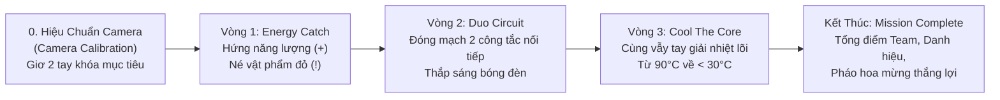
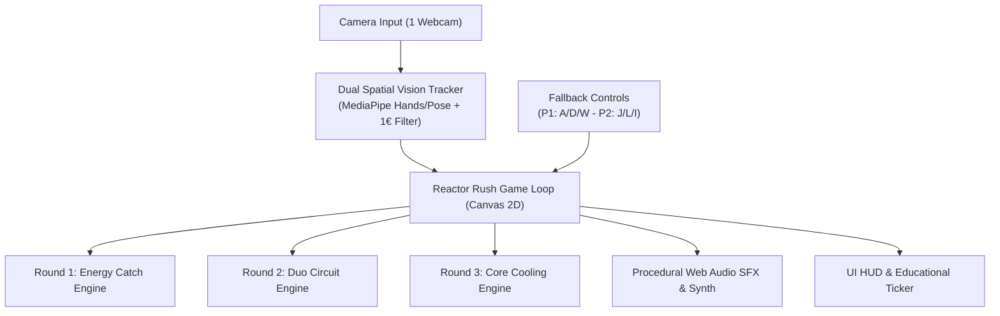

# REACTOR RUSH! — Master Game Design & Architecture Blueprint
**Chế độ / Tựa game:** REACTOR RUSH! (STEM FAIR 2026)  
**Tổ chức phát triển:** CLB Lập Trình FU-DEVER — Trường Đại học FPT Đà Nẵng  
**Tham chiếu gốc:** Video Concept Mockup `demo.mp4`  

---

## 🎯 1. Tầm Nhìn & Phân Tích Video Concept (`demo.mp4`)

Video concept `demo.mp4` mô tả một tựa game tương tác hội trường / gian hàng khoa học (**STEM Fair 2026**) đỉnh cao với khẩu hiệu:
> **"2 NGƯỜI • 3 VÒNG • 1 NHIỆM VỤ"**  
> **"ARCADE • WEBCAM • TEAMWORK"**  
> *"Khoa học dành cho tất cả mọi người (Science is for everyone)"*

### 4 Phân Cảnh Cốt Lõi Được Trích Xuất:

---

## 🎮 2. Chi Tiết Thiết Kế Gameplay 3 Vòng Chơi (Core Mechanics)

### 🚀 Giai Đoạn 0: Hiệu Chuẩn Camera (Camera Calibration)
- **Giao diện:** Chia 2 khung lưới tọa độ cho `PLAYER 1` (Xanh Cyan) và `PLAYER 2` (Hồng Pink).
- **Hành động:** Người chơi đứng trước 1 webcam chung, lùi lại 1.2m – 1.8m và **giơ cả 2 tay lên cao** (`RAISE HANDS`).
- **Phản hồi:** Trạng thái chuyển từ `SEARCHING...` ➔ `TRACKING ACTIVE` ➔ `READY [✓]`.
- **Thanh nạp năng lượng (Ready Bar):** Khi cả 2 người cùng giữ tư thế sẵn sàng trong 2 giây, thanh tiến trình xanh neon chạy đầy và chuyển ngay vào Vòng 1.

### ⚡ Vòng 1: Thu Thập Năng Lượng (ROUND 01 — ENERGY CATCH)
- **Thời lượng:** 30 – 45 giây.
- **Khẩu hiệu:** `Dùng tay điều khiển robot • Bắt năng lượng • Tránh vật phẩm đỏ`.
- **Cơ chế điều khiển:**
  - Vị trí trục X của bàn tay/cơ thể điều khiển Robot P1 (nửa sân trái) và Robot P2 (nửa sân phải) lướt ngang mượt mà trên sàn đấu.
- **Hệ thống Vật phẩm:**
  - `Hạt Năng Lượng Vàng (+)`: +10 điểm.
  - `Hạt Năng Lượng Lục (+)`: +20 điểm.
  - `Hạt Năng Lượng Lam (+)`: +20 điểm.
  - `Vật phẩm Đỏ Cảnh Báo (!)`: Gai/xung điện từ gây giật tia sét, trừ điểm hoặc đóng băng robot trong 1 giây.
- **Đặc trưng Teamwork (Sync Combo):**
  - Khi cả P1 và P2 cùng hứng hạt năng lượng trong khoảng thời gian $\Delta t < 0.5\text{s}$, kích hoạt vòng từ trường liên kết nối giữa 2 robot với thông báo nổi: **`SYNC COMBO +15!`**.
- **Chân trang Tri thức:** `SCIENCE: NĂNG LƯỢNG CÓ THỂ ĐƯỢC CHUYỂN HÓA`.

### 💡 Vòng 2: Mạch Điện Đồng Đội (ROUND 02 — DUO CIRCUIT)
- **Thời lượng:** 15 – 20 giây (gồm 3 đến 5 nhịp đóng mở mạch).
- **Khẩu hiệu:** `Cả hai cùng giơ tay để đóng công tắc và thắp sáng bóng đèn`.
- **Cơ chế:**
  - Bên trái: Công tắc P1 (`OFF` / `ON`).
  - Bên phải: Công tắc P2 (`OFF` / `ON`).
  - Ở giữa: Bóng đèn sợi đốt khoa học khổng lồ.
  - Khi chỉ có 1 người giơ tay: Hệ thống hiển thị `WAIT FOR YOUR TEAMMATE...` và mạch điện bị ngắt quãng.
  - Khi **CẢ HAI CÙNG GIƠ TAY**: Hai đường dây dẫn bừng sáng luồng electron vàng kim, bóng đèn sáng rực hào quang hạt photon, hiển thị **`CIRCUIT COMPLETE!`** (+200 điểm/lần).
- **Chân trang Tri thức:** `SCIENCE: 2 CÔNG TẮC NỐI TIẾP PHẢI CÙNG ĐÓNG`.

### ❄️ Vòng 3: Giải Nhiệt Lò Phản Ứng (ROUND 03 — COOL THE CORE)
- **Thời lượng:** 25 – 30 giây.
- **Khẩu hiệu:** `Phối hợp làm mát reactor bằng chuyển động tay`.
- **Cơ chế:**
  - Ở giữa màn hình là Lò Phản Ứng khổng lồ đang quá nhiệt ở mức nguy hiểm: `REACTOR 90°C` (viền đỏ nhấp nháy báo động).
  - Hai robot P1 và P2 ở hai bên liên tục quạt tay / vẫy tay thật nhanh về phía lò (`> >` và `< <`).
  - Mỗi cú vung tay phóng ra các luồng sóng gió lạnh và hạt băng tuyết xanh cyan lao thẳng vào tâm lõi lò phản ứng.
  - Nhiệt độ tụt dốc liên tục: `90°C` ➔ `79°C` ➔ `68°C` ➔ `56°C` ➔ **`FINAL BOOST! 44°C`** ➔ `33°C` ➔ `28°C` (Vùng an toàn màu lục).
  - Thanh đo nhiệt độ `TEMP.` chuyển từ đỏ rực sang xanh lá cây thanh bình.
- **Chân trang Tri thức:** `SCIENCE: CẢM BIẾN ĐO NHIỆT VÀ HỆ THỐNG PHẢN HỒI`.

### 🏆 Màn Tổng Kết (MISSION COMPLETE!)
- Pháo hoa giấy (confetti) rực rỡ toàn màn hình.
- Tên Đội: `TEAM NOVA` (hoặc tùy biến tên 2 người chơi).
- Đồng hồ tính tổng điểm nhảy số mượt mà từ 0 ➔ 1,280+ điểm.
- Huy hiệu vinh danh: `SCIENCE EXPLORERS`.
- Thông điệp: `SCIENCE IS FOR EVERYONE`.
- Footer: `POWERED BY FU-DEVER • STEM FAIR 2026`.

---

## 🛠️ 3. Kiến Trúc Kỹ Thuật (Technical Implementation)

1. **Vision Engine (Cảm biến 2 người chơi trên 1 Camera):**
   - Kế thừa và mở rộng `dualTracker.js` và `handDetector.js`:
   - Phân chia trường nhìn Webcam thành 2 nửa: Left ROI (Player 1) và Right ROI (Player 2).
   - Nhận diện vị trí lòng bàn tay/khớp tay qua MediaPipe Hand/Pose để tính tọa độ ngang (Vòng 1), nâng cao tay quá ngực (Vòng 2), và vận tốc vẫy tay $|\Delta X/\Delta t| + |\Delta Y/\Delta t|$ (Vòng 3).
   - Lọc nhiễu chống rung giật bằng **1€ Filter**.
2. **Động cơ Đồ họa Vector Canvas 2D:**
   - Vẽ trực tiếp 2 Robot P1 (Cyan) & P2 (Pink) với hiệu ứng mắt LED chớp nháy, ăng-ten lắc lư, và bánh xe xoay.
   - Hiệu ứng hồ quang điện, bóng đèn filament, lò phản ứng hạt nhân hạt glow, và bão tuyết giải nhiệt.
3. **Phím Tắt Dự Phòng (Booth Fallback):**
   - P1: Phím `A` (Trái), `D` (Phải), `W` (Giơ tay / Vẫy).
   - P2: Phím `J` (Trái), `L` (Phải), `I` (Giơ tay / Vẫy).
   - Đảm bảo 100% không bao giờ bị nghẽn trải nghiệm tại gian hàng nếu ánh sáng môi trường hội chợ quá tối hoặc đông người che khuất.
4. **Kiểm thử Tự động (Zero-Regression):**
   - Thêm test suite `test/test-reactor-rush.js` kiểm thử độc lập máy trạng thái 3 vòng, thuật toán Sync Combo, mạch điện nối tiếp và đo vận tốc làm mát lõi.
   - Giữ nguyên 100% pass 6 test suite hiện tại của `bug-dash`.
