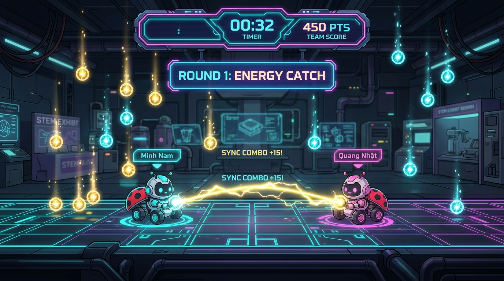
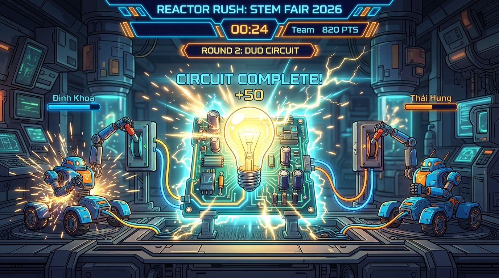
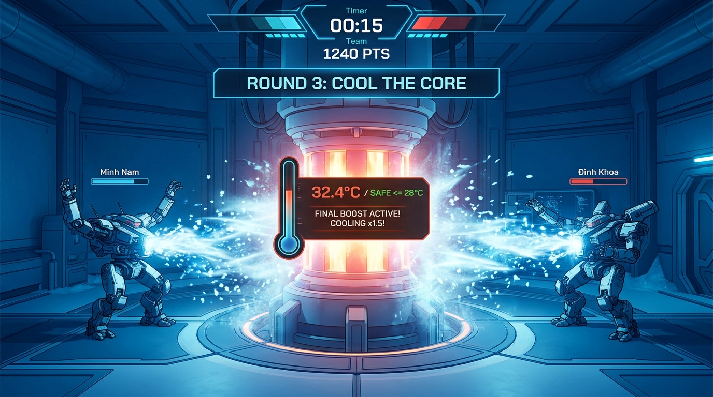
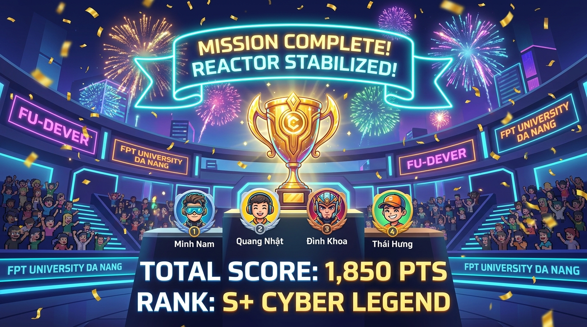

# ⚡ REACTOR RUSH (STEM FAIR 2026) — GAMEPLAY DEMO SHOWCASE

Chào mừng bạn đến với bộ sưu tập hình ảnh trực quan mô phỏng chế độ chơi co-op 2 người **REACTOR RUSH** của CLB FU-DEVER!

Toàn bộ các ảnh chụp màn hình demo 4K độ nét cao được đặt trực tiếp trong thư mục [`./demo_screenshots/`](./demo_screenshots/) để bạn có thể mở xem trực tiếp trên máy tính hoặc xem Markdown preview.

---

## 📸 Bộ Sưu Tập Ảnh Chụp Màn Hình Demo Gameplay

### 1. Vòng 1: Energy Catch (Hứng Hạt Năng Lượng & Sync Combo)

* **Cặp đôi thi đấu:** P1 (Thành viên 1) & P2 (Thành viên 2).
* **Cơ chế Computer Vision:** 
  - Người chơi đứng trước webcam, di chuyển sang trái/phải để điều khiển 2 robot **Cyber Buggy Cyan** và **Cyber Buggy Pink**.
  - Tọa độ bàn tay được phân vùng: Nửa trái màn hình cho P1 ($x < 0.5$), nửa phải màn hình cho P2 ($x \ge 0.5$).
* **Điểm nhấn gameplay:**
  - Hứng hạt năng lượng vàng (+10 điểm), xanh lam (+25 điểm), kim cương tím (+50 điểm) và né tránh gai điện đỏ (-15 điểm).
  - Khi cả 2 người chơi cùng bắt trúng hạt trong khoảng thời gian $\le 0.35$s, một tia điện hồ quang rực sáng sẽ nối liền 2 xe kèm thông báo nổi: **`SYNC COMBO +15!`**.

---

### 2. Vòng 2: Duo Circuit (Mạch Điện Nối Tiếp & Thắp Sáng Bóng Đèn)

* **Đổi ca luân phiên:** Màn hình nghỉ 10 giây thông báo thành viên tiếp theo vào sân (Thành viên 3 & 4).
* **Cơ chế Computer Vision:**
  - Cả 2 người chơi cùng giơ tay lên cao trước camera để đóng 2 công tắc gạt mạch điện.
  - Cần cả 2 tay cùng giơ đồng thời thì dòng điện mới chạy thông suốt qua mạch nối tiếp, sạc năng lượng vào tụ điện.
* **Điểm nhấn gameplay:**
  - Khi thanh nạp đầy 100%, bóng đèn trung tâm sẽ bùng nổ ánh sáng kèm tiếng chuông điện và hiệu ứng **`CIRCUIT COMPLETE! +50`**.
  - Đội cần hoàn thành 4 xung nạp thành công trước khi hết thời gian 35 giây.

---

### 3. Vòng 3: Cool The Core (Hạ Nhiệt Lò Phản Ứng)

* **Cặp đôi quyết định:** Cặp thành viên luân phiên cuối cùng bước vào vị trí thi đấu.
* **Cơ chế Computer Vision:**
  - Thuật toán đo vận tốc chuyển động bàn tay liên tục (`waveVelocity`).
  - Người chơi cật lực vẫy 2 tay qua lại thật nhanh trước camera để tạo ra các luồng sóng tuyết và khí lạnh cực mạnh xả thẳng vào tâm lò phản ứng.
* **Điểm nhấn gameplay:**
  - Nhiệt độ lò khởi đầu ở mức báo động **90°C**. Mục tiêu là hạ nhiệt về vùng an toàn **$\le 28°C$**.
  - Khi nhiệt độ hạ xuống dưới **50°C**, hệ thống tự động kích hoạt **`⚡ FINAL BOOST (Cooling x1.5!)`**, tăng gấp rưỡi công suất làm mát để cả đội bứt phá về đích ngoạn mục!

---

### 4. Vinh Danh Toàn Đội (Mission Complete & Reactor Stabilized!)

* **Bảng vinh danh vinh quang:** Tự động hiển thị **đầy đủ tên của cả 4 bạn trong đội** (không chỉ riêng 2 người chơi cuối).
* **Điểm số & Xếp hạng:** Tổng điểm tích lũy chung của cả 3 vòng được cộng dồn kèm xếp hạng huy chương (**S+ Cyber Legend**, **S Gold Pioneer**, ...).
* Hiệu ứng pháo hoa neon, cúp vàng Cyber Trophy và linh thú bọ Buggy nhảy múa chúc mừng.

---

## 🛠️ Hướng Dẫn Khắc Phục Khi Mở Trình Duyệt Bị Chậm / Lag

Nếu bạn truy cập `http://localhost:5173/` thấy load lâu hoặc trình duyệt báo đơ/chậm, dưới đây là nguyên nhân và cách xử lý nhanh chóng:

1. **Nguyên nhân chính:** 
   - Lần đầu tiên chạy, trình duyệt cần tải model AI MediaPipe (`@mediapipe/tasks-vision` và weights BlazeFace/HandLandmarker ~30MB) từ Google CDN về cache máy.
   - Nếu đường truyền mạng chập chờn, việc tải model này có thể bị treo hoặc mất vài phút.
2. **Cách xử lý tối ưu:**
   - **Tắt bớt extension chặn script:** Đảm bảo AdBlock hoặc Brave Shields không chặn kết nối tới `cdn.jsdelivr.net`.
   - **Mở tab ẩn danh (Incognito) hoặc Chrome mới:** Giúp giải phóng bộ nhớ RAM và tải tài nguyên sạch sẽ.
   - **Chơi bằng phím tắt dự phòng:**
     * **P1:** Phím <kbd>A</kbd> / <kbd>D</kbd> để di chuyển, phím <kbd>W</kbd> để giơ tay / vẫy tay.
     * **P2:** Phím <kbd>J</kbd> / <kbd>L</kbd> để di chuyển, phím <kbd>I</kbd> để giơ tay / vẫy tay.
     * **Toàn màn hình TV:** Bấm phím <kbd>F</kbd> để bật chế độ TV toàn màn hình không viền.
