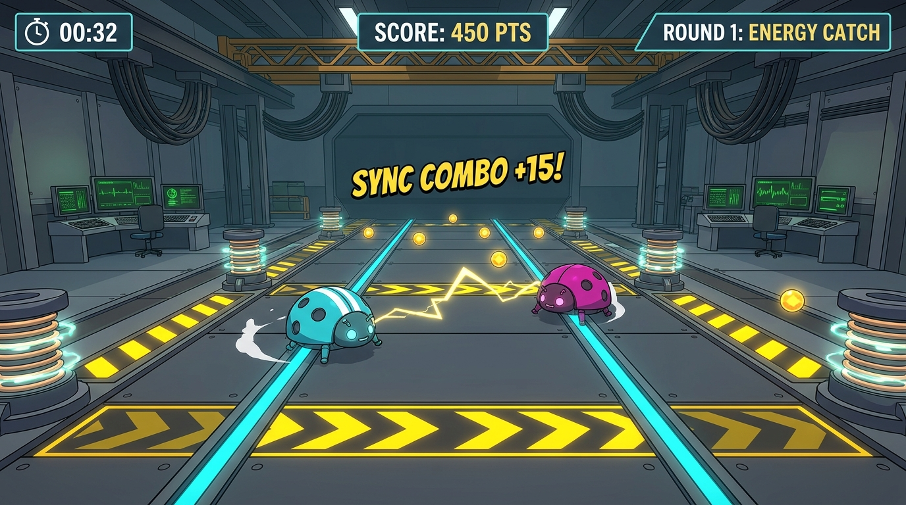
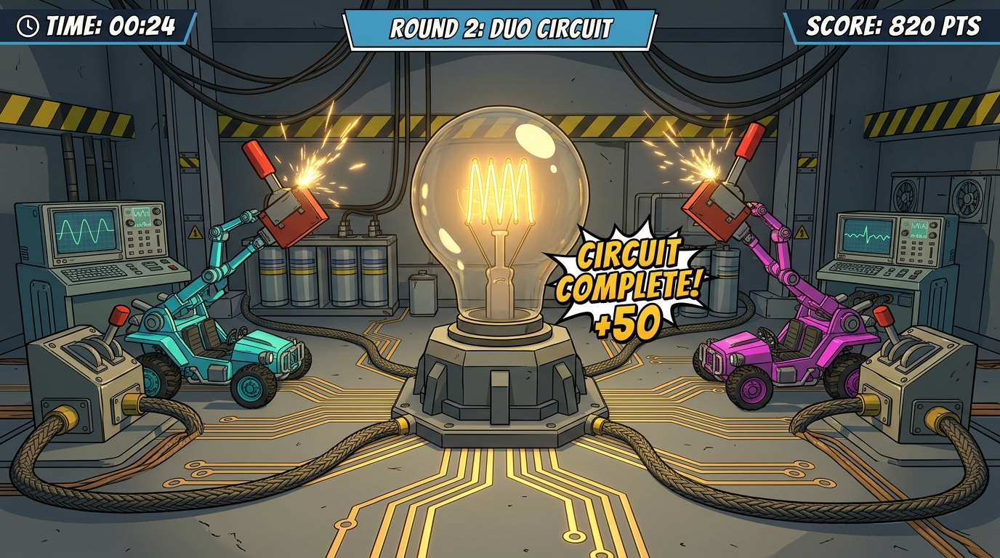
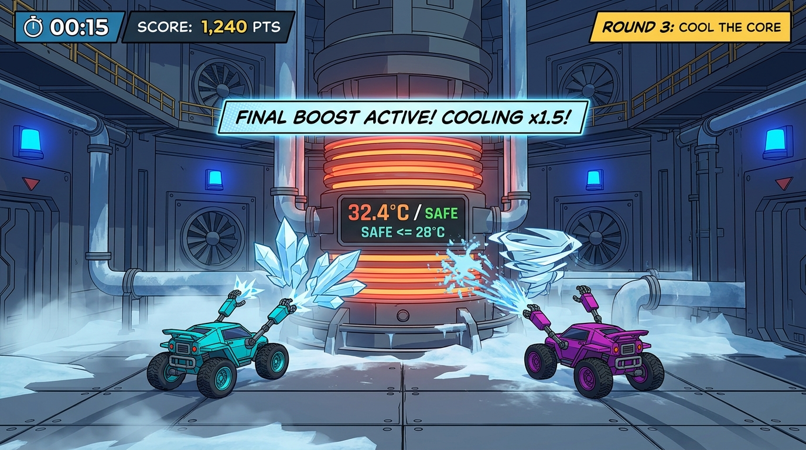
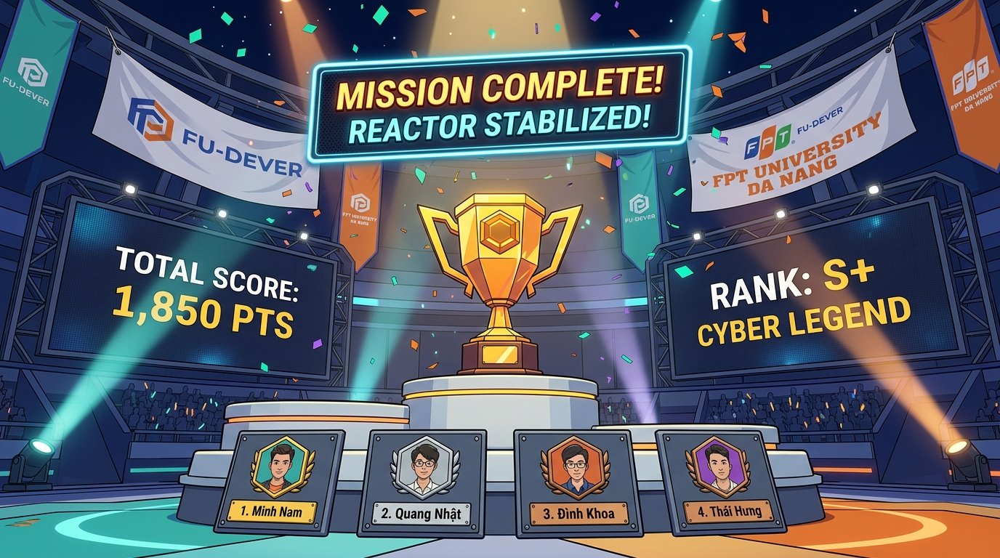

# ⚡ REACTOR RUSH (STEM FAIR 2026) — GAMEPLAY DEMO SHOWCASE (BẢN ĐẠI TU ĐỒ HỌA CEL-SHADED)

Chào mừng bạn đến với bộ sưu tập hình ảnh trực quan mô phỏng chế độ chơi co-op 2 người **REACTOR RUSH** của CLB FU-DEVER!

Toàn bộ 4 phân cảnh gameplay đã được đại tu toàn diện theo chuẩn **Stylized 3D Cel-shaded Indie Game** (áp dụng kỹ năng mới `fu-dever-game-art-craftsman`):
- **Xóa bỏ hoàn toàn "AI Slop":** Không bóng nhựa silicon, không rác hạt bụi vô định, không lem màu bóng đổ.
- **Nâng cấp Map & Môi trường có chiều sâu:** Bổ sung sàn thép công nghiệp dập nổi vạch kẻ làn LED cyan, vạch vàng chevron cảnh báo an toàn, trạm đo đạc chẩn đoán, dàn dây cáp treo trần xưởng và hệ thống cơ khí logic cho từng vòng.
- **Độ nét 16:9 4K sắc nét:** Tối ưu tương phản cao cho màn hình TV lớn và máy chiếu hội trường STEM Fair 2026.

---

## 📸 Bộ Sưu Tập 4 Bản Đồ & Phân Cảnh Gameplay Đã Nâng Cấp

### 1. Vòng 1: Energy Catch (Sàn Đấu Thu Thập Năng Lượng & Sync Combo)

* **Cặp đôi thi đấu:** P1 (Thành viên 1) & P2 (Thành viên 2).
* **Chi tiết Môi trường (Map):** 
  - Sàn thép công nghiệp với 2 đường ray LED cyan phát sáng, vạch cảnh báo an toàn chevron vàng đen, và các trụ nam châm từ trường ở 2 biên sân đấu.
  - Hậu cảnh xưởng chế tạo với dàn cần cẩu giàn giáo (overhead crane girders), dây cáp treo và các trạm máy tính chẩn đoán hiển thị đồ thị nhịp tim/năng lượng màu xanh lá.
* **Cơ chế gameplay & Computer Vision:**
  - Hai người chơi đứng trước webcam, di chuyển sang trái/phải để điều khiển 2 xe bọ **Cyber Buggy Cyan** và **Cyber Buggy Pink** lướt trên sàn hứng các hạt năng lượng vàng (+10 điểm).
  - Khi cả 2 bắt trúng cùng lúc ($\Delta t \le 0.35$s), tia sét hồ quang điện hình học phóng nối giữa 2 xe kèm hiệu ứng nổi: **`SYNC COMBO +15!`**.

---

### 2. Vòng 2: Duo Circuit (Trạm Thí Nghiệm Mạch Điện Cao Thế & Giơ Tay Đóng Mạch)

* **Đổi ca luân phiên:** Màn hình nghỉ 10 giây thông báo thành viên tiếp theo vào sân (Thành viên 3 & 4).
* **Chi tiết Môi trường (Map):**
  - Trung tâm là khối bóng đèn sợi đốt khổng lồ đặt trên bệ đỡ kim loại lục giác, các đường mạch in đồng mạ vàng (PCB copper traces) phát sáng chạy dọc mặt sàn.
  - Hai bên là 2 bục công tắc gạt cơ khí công nghiệp màu đỏ (Industrial Knife-Switches) nối liền bằng các bó dây cáp bện chịu tải cao.
  - Phía sau là dàn tụ điện cao áp (capacitor banks) và máy đo dao động ký (oscilloscope).
* **Cơ chế gameplay & Computer Vision:**
  - Cả 2 người chơi cùng giơ tay lên cao trước camera để robot vươn cánh tay cơ khí gạt đồng thời 2 công tắc. Dòng điện cao áp chạy qua thắp sáng rực rỡ bóng đèn trung tâm kèm hiệu ứng nổ pháo hoa truyện tranh **`CIRCUIT COMPLETE! +50`**.

---

### 3. Vòng 3: Cool The Core (Buồng Lò Phản Ứng Cryo & Vẫy Tay Cực Đại)

* **Cặp đôi quyết định:** Lượt đổi ca cuối cùng đưa cặp đôi bứt phá vào sân.
* **Chi tiết Môi trường (Map):**
  - Lò phản ứng hạt nhân hình trụ khổng lồ ở giữa với các vòng dây nhiệt phát sáng cam đỏ rực, tích hợp đồng hồ nhiệt độ điện tử lớn: **`32.4°C / SAFE <= 28°C`**.
  - Hệ thống ống dẫn khí hóa lỏng làm lạnh (cryogenic pipes) đóng băng tuyết, sàn buồng chứa bốc hơi sương lạnh mờ ảo, tường gia cố chống nổ với quạt hút gió công nghiệp lớn và đèn cảnh báo xanh lam.
* **Cơ chế gameplay & Computer Vision:**
  - Cả 2 cật lực vẫy tay qua lại thật nhanh trước camera để robot phóng các tinh thể băng hình học, bão tuyết và lốc xoáy khí lạnh dập tắt nhiệt lượng lò phản ứng.
  - Khi nhiệt độ hạ xuống dưới 50°C, hệ thống tự động kích hoạt **`⚡ FINAL BOOST ACTIVE! COOLING x1.5!`** đẩy tốc độ làm mát lên mức tối đa!

---

### 4. Vinh Danh Toàn Đội: Mission Complete (Đại Sân Khấu Vinh Danh STEM Fair 2026)

* **Chi tiết Môi trường (Map):**
  - Khán đài sân khấu đại lễ hội triển lãm khoa học STEM Fair 2026 với bục podium vinh danh bậc thang trung tâm.
  - Chiếc Cúp Vàng Cyber Trophy đa giác độc bản, pháo hoa giấy hình học (geometric confetti) tung bay, đèn chiếu spotlight rực rỡ.
  - Màn hình LED thể thao cỡ lớn hiển thị **`TOTAL SCORE: 1,850 PTS`** và **`RANK: S+ CYBER LEGEND`**.
  - Hai bên treo trang trọng dải cờ hiệu và biểu trưng chính thức của **`FU-DEVER`** và **`FPT UNIVERSITY DA NANG`**.
* **Vinh danh trọn vẹn 4 thành viên:**
  - Dưới chân bục có 4 kỷ niệm chương mang avatar và tên đầy đủ của cả 4 bạn: **`1. Minh Nam`**, **`2. Quang Nhật`**, **`3. Đình Khoa`**, **`4. Thái Hưng`**.

---

## 🛠️ Hướng Dẫn Mở & Trải Nghiệm Trực Tiếp
* Tất cả ảnh được lưu với độ phân giải cao tại thư mục: [`./demo_screenshots/`](./demo_screenshots/).
* Bạn có thể mở trực tiếp từng file ảnh bằng bất kỳ trình xem ảnh nào trên máy tính, hoặc mở bản xem trước Markdown trong VS Code / IDE.
