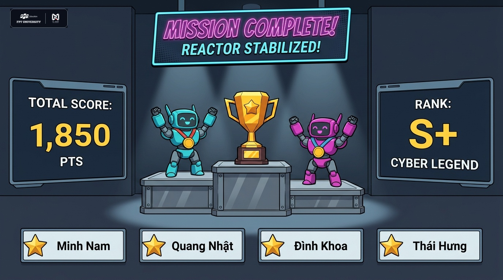

# ⚡ REACTOR RUSH (STEM FAIR 2026) — GAMEPLAY DEMO SHOWCASE (BẢN ĐỒNG BỘ NGHỆ THUẬT & HUD CHUẨN HOÁ)

Chào mừng bạn đến với bộ sưu tập hình ảnh trực quan mô phỏng chế độ chơi co-op 2 người **REACTOR RUSH** của CLB FU-DEVER!

Toàn bộ 4 phân cảnh gameplay đã được chuẩn hóa toàn diện theo chuẩn **Stylized 3D Cel-shaded Indie Game** kết hợp hệ thống **Fixed Cockpit HUD Vector Layer** (áp dụng kỹ năng `fu-dever-game-art-craftsman`):
- **Thống nhất tuyệt đối hệ thống HUD (Time & Points):** Cả 3 vòng chơi đầu sở hữu chung một bộ khung HUD cố định, cùng vị trí tọa độ, cùng font chữ Monospace, cùng kích thước thẻ pill kính mờ và màu sắc nhận diện (Cyber Cyan & DEVER Amber).
- **Vinh danh đồng đội không số thứ tự:** Bảng điểm vòng 4 hiển thị đầy đủ tên 4 bạn trong cùng 1 đội chiến thắng dưới dạng thẻ bài đồng đẳng (không có số `1, 2, 3, 4` gây hiểu lầm xếp hạng cá nhân).
- **Đồng bộ 1 phong cách đồ họa xuyên suốt (Anti-AI Slop):** Nét mực viền `ink line-art 1.5px`, đổ bóng phẳng 2 tầng `two-tone stepped shadows`, bề mặt sơn mờ nhám công nghiệp, loại bỏ 100% bóng nhựa silicon và rác hạt bụi AI.
- **Nhân vật đồng nhất (Single Model Sheet):** Cặp đôi robot bọ máy **Cyber Buggy Cyan (P1)** và **Cyber Buggy Magenta (P2)** giữ nguyên kiểu dáng, ăng-ten đôi, đèn mắt laser tròn và vạch đua trắng qua mọi màn chơi.

---

## 📸 Bộ Sưu Tập 4 Bản Đồ & Phân Cảnh Gameplay Đã Chuẩn Hóa

### 1. Vòng 1: Energy Catch (Sàn Đấu Thu Thập Năng Lượng & Sync Combo)

* **Hệ thống HUD Chuẩn Hóa:**
  - **Góc Trái:** Badge chế độ `⚡ REACTOR RUSH | ROUND 1: ENERGY CATCH` viền Cyan.
  - **Chính Giữa:** Đồng hồ đếm ngược kỹ thuật số `⏱ 00:32` font Monospace sắc nét.
  - **Góc Phải:** Bảng điểm tích lũy chung `★ SCORE: 450 PTS` viền Amber.
* **Cặp đôi thi đấu:** P1 (Thành viên 1) & P2 (Thành viên 2).
* **Chi tiết Môi trường (Map):** 
  - Sàn thép công nghiệp với 2 đường ray LED cyan phát sáng, vạch cảnh báo an toàn chevron vàng đen, và các trụ nam châm từ trường ở 2 biên sân đấu.
  - Hậu cảnh xưởng chế tạo với dàn cần cẩu giàn giáo (overhead crane girders), dây cáp treo và các trạm máy tính chẩn đoán hiển thị đồ thị nhịp tim/năng lượng màu xanh lá.
* **Cơ chế gameplay & Computer Vision:**
  - Hai người chơi đứng trước webcam, di chuyển sang trái/phải để điều khiển 2 xe bọ **Cyber Buggy Cyan** và **Cyber Buggy Pink** lướt trên sàn hứng các hạt năng lượng vàng (+10 điểm).
  - Khi cả 2 bắt trúng cùng lúc ($\Delta t \le 0.35$s), tia sét hồ quang điện hình học phóng nối giữa 2 xe kèm hiệu ứng nổi: **`SYNC COMBO +15!`**.

---

### 2. Vòng 2: Duo Circuit (Trạm Thí Nghiệm Mạch Điện Cao Thế & Giơ Tay Đóng Mạch)

* **Hệ thống HUD Chuẩn Hóa:**
  - **Góc Trái:** Badge chế độ `⚡ REACTOR RUSH | ROUND 2: DUO CIRCUIT` viền Cyan (tọa độ và kích thước giống hệt Vòng 1).
  - **Chính Giữa:** Đồng hồ đếm ngược kỹ thuật số `⏱ 00:24` (chuẩn vị trí trung tâm).
  - **Góc Phải:** Bảng điểm tích lũy chung `★ SCORE: 820 PTS` (chuẩn vị trí góc phải).
* **Đổi ca luân phiên:** Màn hình nghỉ 10 giây thông báo thành viên tiếp theo vào sân (Thành viên 3 & 4).
* **Chi tiết Môi trường (Map):**
  - Trung tâm là khối bóng đèn sợi đốt khổng lồ đặt trên bệ đỡ kim loại lục giác, các đường mạch in đồng mạ vàng (PCB copper traces) phát sáng chạy dọc mặt sàn.
  - Hai bên là 2 bục công tắc gạt cơ khí công nghiệp màu đỏ (Industrial Knife-Switches) nối liền bằng các bó dây cáp bện chịu tải cao.
* **Cơ chế gameplay & Computer Vision:**
  - Cả 2 người chơi cùng giơ tay lên cao trước camera để robot vươn cánh tay cơ khí gạt đồng thời 2 công tắc. Dòng điện cao áp chạy qua thắp sáng rực rỡ bóng đèn trung tâm kèm hiệu ứng nổ pháo hoa truyện tranh **`CIRCUIT COMPLETE! +50`**.

---

### 3. Vòng 3: Cool The Core (Buồng Lò Phản Ứng Cryo & Vẫy Tay Cực Đại)

* **Hệ thống HUD Chuẩn Hóa:**
  - **Góc Trái:** Badge chế độ `⚡ REACTOR RUSH | ROUND 3: COOL THE CORE` viền Cyan.
  - **Chính Giữa:** Đồng hồ đếm ngược kỹ thuật số `⏱ 00:15` (chuẩn vị trí trung tâm).
  - **Góc Phải:** Bảng điểm tích lũy chung `★ SCORE: 1,240 PTS` (chuẩn vị trí góc phải).
* **Cặp đôi quyết định:** Lượt đổi ca cuối cùng đưa cặp đôi bứt phá vào sân.
* **Chi tiết Môi trường (Map):**
  - Lò phản ứng hạt nhân hình trụ khổng lồ ở giữa với các vòng dây nhiệt phát sáng cam đỏ rực, tích hợp đồng hồ nhiệt độ điện tử lớn: **`32.4°C / SAFE <= 28°C`**.
  - Hệ thống ống dẫn khí hóa lỏng làm lạnh (cryogenic pipes) đóng băng tuyết, sàn buồng chứa bốc hơi sương lạnh mờ ảo, tường gia cố chống nổ với quạt hút gió công nghiệp lớn và đèn cảnh báo xanh lam.
* **Cơ chế gameplay & Computer Vision:**
  - Cả 2 cật lực vẫy tay qua lại thật nhanh trước camera để robot phóng các tinh thể băng hình học, bão tuyết và lốc xoáy khí lạnh dập tắt nhiệt lượng lò phản ứng.
  - Khi nhiệt độ hạ xuống dưới 50°C, hệ thống tự động kích hoạt **`⚡ FINAL BOOST ACTIVE! COOLING x1.5!`** đẩy tốc độ làm mát lên mức tối đa!

---

### 4. Vinh Danh Toàn Đội: Mission Complete (Đại Sân Khấu Vinh Danh STEM Fair 2026)

#### 🌟 Bản In-Game Cel-Shaded Thuần Túy (Đồng Đội Không Số Thứ Tự, Tách Bố Cục Không Che Chữ):

* **Nhân vật tâm điểm:** Hai robot **Cyber Buggy Cyan** và **Cyber Buggy Pink** đeo huy chương vàng, giơ tay ăn mừng chiến thắng trên bậc bục podium bên cạnh chiếc Cúp Vàng đa giác độc bản.
* **Bố cục phân cánh thông minh (Zero Text Occlusion):** Hai màn hình hiển thị được tách riêng biệt sang 2 cánh trái/phải (`TOTAL SCORE: 1,850 PTS` bên trái và `RANK: S+ CYBER LEGEND` bên phải); khoảng không gian phía sau chiếc cúp ở giữa là nền tối sạch có đèn spotlight rọi xuống — **100% không còn chữ nào bị cúp hay nhân vật che khuất**. Phía trên đỉnh là dải băng neon **`MISSION COMPLETE! REACTOR STABILIZED!`**.
* **Bảng vinh danh đội chiến thắng (Không số thứ tự):** 4 thẻ kỷ niệm chương phẳng ngang hàng với icon ngôi sao vàng mang tên đầy đủ của 4 bạn trong đội:
  - `⭐ Minh Nam`
  - `⭐ Quang Nhật`
  - `⭐ Đình Khoa`
  - `⭐ Thái Hưng`  
  *(Tuyệt đối không đánh số `1., 2., 3., 4.` để tôn vinh trọn vẹn tinh thần đồng đội co-op cùng thắng).*
* **Hiệu ứng sân khấu:** Ánh đèn chiếu spotlight góc rộng, tường kim loại công nghiệp màu xám đậm đồng bộ với 3 map trước.

#### 🏛️ Bản Gắn Logo Chính Thức Của CLB & Trường (Official Branding):

* Được ghép trực tiếp từ file vector chuẩn gốc trong thư mục `DeverLogo/` (`fptu_logo_white.png` và `dever_logo_white.png`) ở góc trên — sắc nét 100%, bảo đảm nhận diện thương hiệu tuyệt đối và loại bỏ hoàn toàn các dị tật "logo lỏ" do AI vẽ bừa.

---

## 🛠️ Hướng Dẫn Mở & Trải Nghiệm Trực Tiếp
* Tất cả ảnh đã được lưu với độ phân giải cao tại thư mục: [`./demo_screenshots/`](./demo_screenshots/).
* Bạn có thể mở trực tiếp từng file ảnh bằng bất kỳ trình xem ảnh nào trên máy tính, hoặc mở bản xem trước Markdown trong VS Code / IDE.
